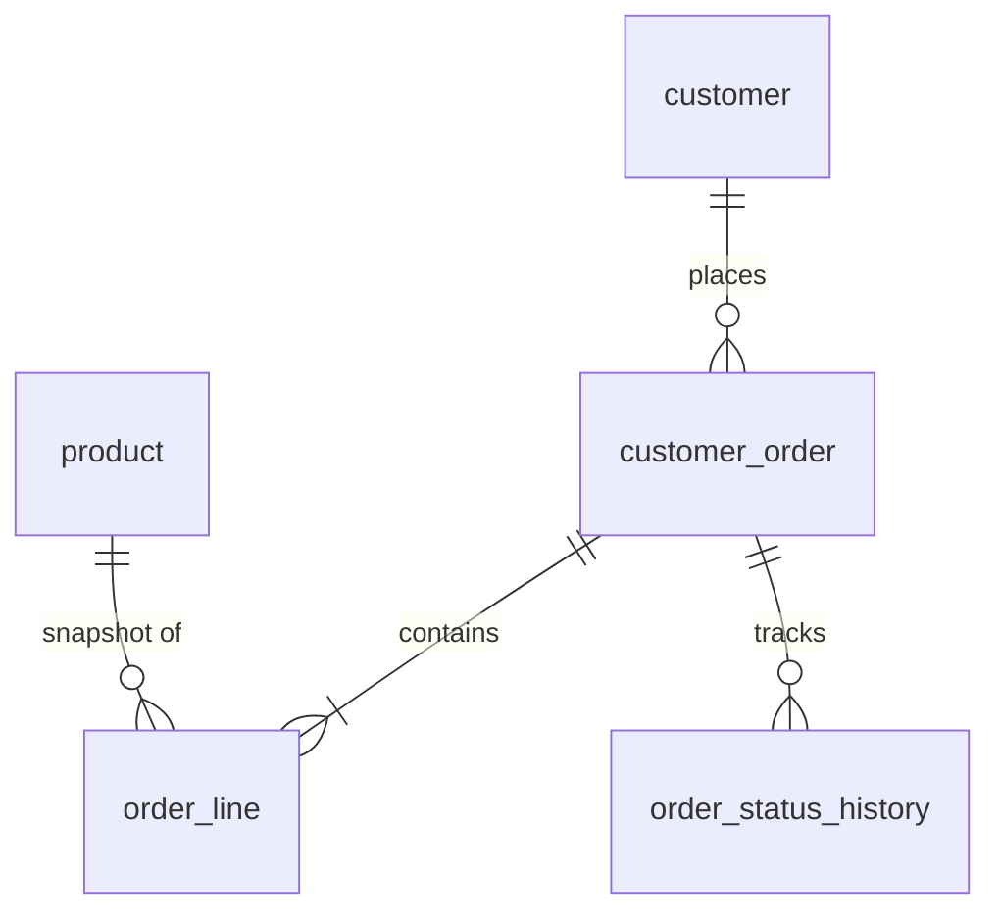

# Database Design – Examples

> Illustration. This is an **illustrative example**, not official business logic or schema. The AI must read the project's FR/BR and DB conventions first; examples here must not be used as business logic.

Context: **Orders** module of an online store, implementation mode, PostgreSQL 18. A MariaDB 10.11 variant is at the end.

## 1. Business analysis (step 1)

| Source | Content | Model consequence |
| --- | --- | --- |
| FR-ORD-01 | Customer places an order with multiple products | `customer_order` 1-n `order_line` |
| BR-ORD-01 | Price on the order is the price at order time | Snapshot `unit_price`, `product_name` into `order_line` |
| BR-ORD-02 | Status: `pending` → `paid` → `shipped` → `completed`; `pending`/`paid` → `cancelled` | `status` column + CHECK; status history table |
| BR-ORD-03 | Order code unique system-wide, visible to customer | `order_code` UNIQUE, separate from primary key |
| BR-ORD-04 | Resending an order request does not create a duplicate order | `idempotency_key` UNIQUE per customer |
| BR-ORD-05 | Quantity per line ≥ 1 | CHECK `quantity > 0` |
| NFR-PERF-02 | Customer order list p95 < 200 ms | AP-01 |

Open questions: `OQ-12` Are orders multi-currency? (assumption: single currency, VND). `OQ-13` Retention period for cancelled orders? (assumption: per general policy, not deleted yet).

## 2. Access patterns and volume (step 2)

| AP | Description | Filter | Sort | Frequency | Index |
| --- | --- | --- | --- | --- | --- |
| AP-01 | Customer's order list | `customer_id` | `created_at DESC`, keyset | High | `ix_customer_order_customer_created` |
| AP-02 | Look up order by code | `order_code` | — | Medium | `uq_customer_order_order_code` |
| AP-03 | Overdue pending-payment orders (job) | `status = 'pending'`, `created_at <` | — | Every minute | `ix_customer_order_pending_created` (partial) |
| AP-04 | Lines of an order | `order_id` | — | High | `ix_order_line_order` (FK) |

Estimate: 20 thousand orders/day, about 7 million orders/year, 3 lines/order. No partitioning needed in year one (tier 1 suffices); reassess when `order_line` exceeds about 100 million rows or when yearly archiving is needed.

## 3. ERD (step 3)



`customer`, `product` belong to other modules; referenced only via FK in the same database per an assumed architecture decision (one shared database).

## 4. Notable design decisions

| Decision | Reason | Rejected option |
| --- | --- | --- |
| PK `bigint identity`, separate order code | Short key, fast joins; order code does not reveal order count | Order code as PK: code format changes propagate to FKs |
| Money `numeric(19,4)` | Exact; room for VND and fractional currencies later | `float`: rounding errors; `bigint` dong: hard if multi-currency (`OQ-12`) |
| `status` as `text` + CHECK | Adding a status only needs a CHECK change | ENUM type: hard to remove values |
| `order_line.product_id` ON DELETE RESTRICT | Order lines not lost when a product is deleted | CASCADE: deletes sales history |
| `order_line.order_id` ON DELETE CASCADE | Order lines fully depend on the order | — |
| Total stored on the order | Order list (AP-01) need not sum lines; computed once at order time and unchanged afterwards | Compute on read: costs a join for a high-frequency AP |

## 5. Migration (step 9) – PostgreSQL

`V20261111_0900__create_order_tables.sql` (up part):

```sql
SET lock_timeout = '5s';

CREATE TABLE customer_order (
    id               bigint GENERATED ALWAYS AS IDENTITY,
    order_code       text          NOT NULL,
    customer_id      bigint        NOT NULL,
    status           text          NOT NULL DEFAULT 'pending',
    total_amount     numeric(19,4) NOT NULL,
    currency         char(3)       NOT NULL DEFAULT 'VND',
    idempotency_key  uuid          NOT NULL,
    paid_at          timestamptz,
    cancelled_at     timestamptz,
    created_at       timestamptz   NOT NULL DEFAULT now(),
    updated_at       timestamptz   NOT NULL DEFAULT now(),
    version          integer       NOT NULL DEFAULT 0,
    CONSTRAINT pk_customer_order PRIMARY KEY (id),
    CONSTRAINT uq_customer_order_order_code UNIQUE (order_code),
    CONSTRAINT uq_customer_order_customer_idempotency UNIQUE (customer_id, idempotency_key),
    CONSTRAINT fk_customer_order_customer FOREIGN KEY (customer_id)
        REFERENCES customer (id) ON DELETE RESTRICT,
    CONSTRAINT ck_customer_order_status
        CHECK (status IN ('pending', 'paid', 'shipped', 'completed', 'cancelled')),
    CONSTRAINT ck_customer_order_total_amount CHECK (total_amount >= 0),
    CONSTRAINT ck_customer_order_paid_at
        CHECK (status NOT IN ('paid', 'shipped', 'completed') OR paid_at IS NOT NULL),
    CONSTRAINT ck_customer_order_cancelled_at
        CHECK (status <> 'cancelled' OR cancelled_at IS NOT NULL)
);

-- AP-01: customer's order list, keyset on (created_at, id)
CREATE INDEX ix_customer_order_customer_created
    ON customer_order (customer_id, created_at DESC, id DESC);
-- AP-03: job scanning overdue pending-payment orders
CREATE INDEX ix_customer_order_pending_created
    ON customer_order (created_at) WHERE status = 'pending';

CREATE TABLE order_line (
    id            bigint GENERATED ALWAYS AS IDENTITY,
    order_id      bigint        NOT NULL,
    product_id    bigint        NOT NULL,
    product_name  text          NOT NULL,
    unit_price    numeric(19,4) NOT NULL,
    quantity      integer       NOT NULL,
    CONSTRAINT pk_order_line PRIMARY KEY (id),
    CONSTRAINT fk_order_line_order FOREIGN KEY (order_id)
        REFERENCES customer_order (id) ON DELETE CASCADE,
    CONSTRAINT fk_order_line_product FOREIGN KEY (product_id)
        REFERENCES product (id) ON DELETE RESTRICT,
    CONSTRAINT uq_order_line_order_product UNIQUE (order_id, product_id),
    CONSTRAINT ck_order_line_unit_price CHECK (unit_price >= 0),
    CONSTRAINT ck_order_line_quantity CHECK (quantity > 0)
);
-- AP-04 is served by uq_order_line_order_product (leading column is order_id), no separate index.
CREATE INDEX ix_order_line_product ON order_line (product_id);  -- FK; product delete/check

CREATE TABLE order_status_history (
    id           bigint GENERATED ALWAYS AS IDENTITY,
    order_id     bigint      NOT NULL,
    from_status  text,
    to_status    text        NOT NULL,
    changed_by   bigint      NOT NULL,
    changed_at   timestamptz NOT NULL DEFAULT now(),
    reason       text,
    CONSTRAINT pk_order_status_history PRIMARY KEY (id),
    CONSTRAINT fk_order_status_history_order FOREIGN KEY (order_id)
        REFERENCES customer_order (id) ON DELETE CASCADE
);
CREATE INDEX ix_order_status_history_order ON order_status_history (order_id, changed_at);

-- Permissions: application does not update/delete status history
GRANT SELECT, INSERT, UPDATE, DELETE ON customer_order, order_line TO app_rw;
GRANT SELECT, INSERT ON order_status_history TO app_rw;
```

Rollback part:

```sql
DROP TABLE order_status_history;
DROP TABLE order_line;
DROP TABLE customer_order;
```

Status transition with optimistic locking and source-status condition (BR-ORD-02):

```sql
UPDATE customer_order
   SET status = 'paid', paid_at = now(), updated_at = now(), version = version + 1
 WHERE id = $1 AND status = 'pending' AND version = $2;
-- 0 rows affected: order already changed status or was modified concurrently → report conflict.
```

Order list (AP-01) by keyset:

```sql
SELECT id, order_code, status, total_amount, created_at
  FROM customer_order
 WHERE customer_id = $1 AND (created_at, id) < ($2, $3)
 ORDER BY created_at DESC, id DESC
 LIMIT 20;
```

## 6. Verification (step 10)

```text
$ docker run -d --name ddl-check -e POSTGRES_PASSWORD=… postgres:18
$ psql … -f prereq.sql -f up.sql            # CREATE TABLE ×3, CREATE INDEX ×4: OK
$ psql … -f down.sql && psql … -f up.sql    # rollback then up again: OK
-- Negative cases:
INSERT … quantity = 0          → ERROR: violates check constraint "ck_order_line_quantity"
INSERT … status = 'paid', paid_at NULL → ERROR: violates check constraint "ck_customer_order_paid_at"
INSERT … duplicate (customer_id, idempotency_key) → ERROR: duplicate key … "uq_customer_order_customer_idempotency"
DELETE FROM product WHERE id = 1 (already in an order) → ERROR: violates foreign key constraint "fk_order_line_product"
-- EXPLAIN AP-01 after loading 200k fake orders: Index Scan using ix_customer_order_customer_created
```

## 7. MariaDB 10.11 variant

Main differences from the PostgreSQL version:

| Point | PostgreSQL | MariaDB 10.11 |
| --- | --- | --- |
| PK | `bigint GENERATED ALWAYS AS IDENTITY` | `BIGINT UNSIGNED AUTO_INCREMENT` (FKs must also be `UNSIGNED`) |
| Timestamp | `timestamptz` | `DATETIME(6)` stored as UTC; connection session sets `time_zone = '+00:00'` |
| UUID | `uuid` | `UUID` (since 10.7) |
| Partial index AP-03 | `WHERE status = 'pending'` | Not available; use index `(status, created_at)` |
| Character set | UTF-8 by default | `DEFAULT CHARSET = utf8mb4 COLLATE = utf8mb4_unicode_520_ci` |
| DDL in transaction | Yes | No; one table per migration or use `IF NOT EXISTS` |

```sql
CREATE TABLE customer_order (
    id               BIGINT UNSIGNED NOT NULL AUTO_INCREMENT,
    order_code       VARCHAR(20)     NOT NULL,
    customer_id      BIGINT UNSIGNED NOT NULL,
    status           VARCHAR(16)     NOT NULL DEFAULT 'pending',
    total_amount     DECIMAL(19,4)   NOT NULL,
    currency         CHAR(3)         NOT NULL DEFAULT 'VND',
    idempotency_key  UUID            NOT NULL,
    paid_at          DATETIME(6)     NULL,
    cancelled_at     DATETIME(6)     NULL,
    created_at       DATETIME(6)     NOT NULL DEFAULT CURRENT_TIMESTAMP(6),
    updated_at       DATETIME(6)     NOT NULL DEFAULT CURRENT_TIMESTAMP(6) ON UPDATE CURRENT_TIMESTAMP(6),
    version          INT UNSIGNED    NOT NULL DEFAULT 0,
    CONSTRAINT pk_customer_order PRIMARY KEY (id),
    CONSTRAINT uq_customer_order_order_code UNIQUE (order_code),
    CONSTRAINT uq_customer_order_customer_idempotency UNIQUE (customer_id, idempotency_key),
    CONSTRAINT fk_customer_order_customer FOREIGN KEY (customer_id)
        REFERENCES customer (id) ON DELETE RESTRICT,
    CONSTRAINT ck_customer_order_status
        CHECK (status IN ('pending', 'paid', 'shipped', 'completed', 'cancelled')),
    CONSTRAINT ck_customer_order_total_amount CHECK (total_amount >= 0),
    CONSTRAINT ck_customer_order_paid_at
        CHECK (status NOT IN ('paid', 'shipped', 'completed') OR paid_at IS NOT NULL),
    CONSTRAINT ck_customer_order_cancelled_at
        CHECK (status <> 'cancelled' OR cancelled_at IS NOT NULL),
    INDEX ix_customer_order_customer_created (customer_id, created_at, id),
    INDEX ix_customer_order_status_created (status, created_at)
) ENGINE = InnoDB DEFAULT CHARSET = utf8mb4 COLLATE = utf8mb4_unicode_520_ci;
```
