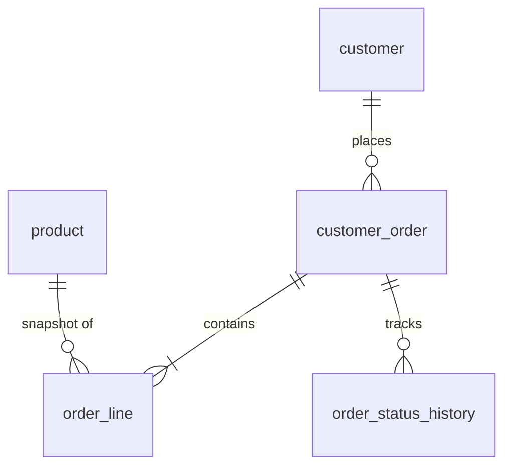

# Database Design – Examples

> Minh hoạ. Đây là **ví dụ minh hoạ**, không phải nghiệp vụ hay schema chính thức. AI phải đọc FR/BR và quy ước CSDL của dự án trước; ví dụ ở đây không được dùng làm nghiệp vụ.

Bối cảnh: module **Đơn hàng** của một cửa hàng trực tuyến, chế độ triển khai, PostgreSQL 18. Phần cuối có biến thể MariaDB 10.11.

## 1. Phân tích nghiệp vụ (bước 1)

| Nguồn | Nội dung | Hệ quả mô hình |
| --- | --- | --- |
| FR-ORD-01 | Khách đặt đơn gồm nhiều sản phẩm | `customer_order` 1-n `order_line` |
| BR-ORD-01 | Giá trên đơn là giá tại thời điểm đặt | Snapshot `unit_price`, `product_name` vào `order_line` |
| BR-ORD-02 | Trạng thái: `pending` → `paid` → `shipped` → `completed`; `pending`/`paid` → `cancelled` | Cột `status` + CHECK; bảng lịch sử trạng thái |
| BR-ORD-03 | Mã đơn duy nhất toàn hệ thống, khách nhìn thấy | `order_code` UNIQUE, tách khỏi khoá chính |
| BR-ORD-04 | Gửi lại yêu cầu đặt đơn không tạo đơn trùng | `idempotency_key` UNIQUE theo khách |
| BR-ORD-05 | Số lượng mỗi dòng ≥ 1 | CHECK `quantity > 0` |
| NFR-PERF-02 | Danh sách đơn của khách p95 < 200 ms | AP-01 |

Câu hỏi mở: `OQ-12` Đơn có đa tiền tệ không? (giả định: một tiền tệ, VND). `OQ-13` Thời hạn lưu đơn đã huỷ? (giả định: theo chính sách chung, chưa xoá).

## 2. Mẫu truy cập và khối lượng (bước 2)

| AP | Mô tả | Lọc | Sắp xếp | Tần suất | Index |
| --- | --- | --- | --- | --- | --- |
| AP-01 | Danh sách đơn của khách | `customer_id` | `created_at DESC`, keyset | Cao | `ix_customer_order_customer_created` |
| AP-02 | Tra đơn theo mã | `order_code` | — | Trung bình | `uq_customer_order_order_code` |
| AP-03 | Đơn chờ thanh toán quá hạn (job) | `status = 'pending'`, `created_at <` | — | Mỗi phút | `ix_customer_order_pending_created` (partial) |
| AP-04 | Dòng của một đơn | `order_id` | — | Cao | `ix_order_line_order` (FK) |

Ước tính: 20 nghìn đơn/ngày, khoảng 7 triệu đơn/năm, 3 dòng/đơn. Năm đầu chưa cần partition (bậc 1 đủ); đánh giá lại khi `order_line` vượt khoảng 100 triệu dòng hoặc khi cần lưu trữ theo năm.

## 3. ERD (bước 3)



`customer`, `product` thuộc module khác; chỉ tham chiếu bằng FK trong cùng CSDL theo quyết định kiến trúc giả định (một CSDL chung).

## 4. Quyết định thiết kế đáng chú ý

| Quyết định | Lý do | Phương án đã loại |
| --- | --- | --- |
| PK `bigint identity`, mã đơn riêng | Khoá ngắn, join nhanh; mã đơn không lộ số lượng đơn | Dùng mã đơn làm PK: đổi định dạng mã lan sang FK |
| Tiền `numeric(19,4)` | Chính xác; dư cho VND và tiền tệ có phần lẻ sau này | `float`: sai số; `bigint` đồng: khó nếu đa tiền tệ (`OQ-12`) |
| `status` dạng `text` + CHECK | Thêm trạng thái chỉ cần đổi CHECK | Kiểu ENUM: khó bỏ giá trị |
| `order_line.product_id` ON DELETE RESTRICT | Không mất dòng đơn khi xoá sản phẩm | CASCADE: xoá lịch sử bán hàng |
| `order_line.order_id` ON DELETE CASCADE | Dòng đơn phụ thuộc hoàn toàn vào đơn | — |
| Tổng tiền lưu trên đơn | Danh sách đơn (AP-01) không phải cộng dòng; tính một lần khi đặt đơn và không đổi sau đó | Tính khi đọc: tốn join cho AP tần suất cao |

## 5. Migration (bước 9) – PostgreSQL

`V20261111_0900__create_order_tables.sql` (phần lên):

```sql
SET lock_timeout = '5s';

CREATE TABLE customer_order (
    id               bigint GENERATED ALWAYS AS IDENTITY,
    order_code       text          NOT NULL,
    customer_id      bigint        NOT NULL,
    status           text          NOT NULL DEFAULT 'pending',
    total_amount     numeric(19,4) NOT NULL,
    currency         char(3)       NOT NULL DEFAULT 'VND',
    idempotency_key  uuid          NOT NULL,
    paid_at          timestamptz,
    cancelled_at     timestamptz,
    created_at       timestamptz   NOT NULL DEFAULT now(),
    updated_at       timestamptz   NOT NULL DEFAULT now(),
    version          integer       NOT NULL DEFAULT 0,
    CONSTRAINT pk_customer_order PRIMARY KEY (id),
    CONSTRAINT uq_customer_order_order_code UNIQUE (order_code),
    CONSTRAINT uq_customer_order_customer_idempotency UNIQUE (customer_id, idempotency_key),
    CONSTRAINT fk_customer_order_customer FOREIGN KEY (customer_id)
        REFERENCES customer (id) ON DELETE RESTRICT,
    CONSTRAINT ck_customer_order_status
        CHECK (status IN ('pending', 'paid', 'shipped', 'completed', 'cancelled')),
    CONSTRAINT ck_customer_order_total_amount CHECK (total_amount >= 0),
    CONSTRAINT ck_customer_order_paid_at
        CHECK (status NOT IN ('paid', 'shipped', 'completed') OR paid_at IS NOT NULL),
    CONSTRAINT ck_customer_order_cancelled_at
        CHECK (status <> 'cancelled' OR cancelled_at IS NOT NULL)
);

-- AP-01: danh sách đơn của khách, keyset theo (created_at, id)
CREATE INDEX ix_customer_order_customer_created
    ON customer_order (customer_id, created_at DESC, id DESC);
-- AP-03: job quét đơn chờ thanh toán quá hạn
CREATE INDEX ix_customer_order_pending_created
    ON customer_order (created_at) WHERE status = 'pending';

CREATE TABLE order_line (
    id            bigint GENERATED ALWAYS AS IDENTITY,
    order_id      bigint        NOT NULL,
    product_id    bigint        NOT NULL,
    product_name  text          NOT NULL,
    unit_price    numeric(19,4) NOT NULL,
    quantity      integer       NOT NULL,
    CONSTRAINT pk_order_line PRIMARY KEY (id),
    CONSTRAINT fk_order_line_order FOREIGN KEY (order_id)
        REFERENCES customer_order (id) ON DELETE CASCADE,
    CONSTRAINT fk_order_line_product FOREIGN KEY (product_id)
        REFERENCES product (id) ON DELETE RESTRICT,
    CONSTRAINT uq_order_line_order_product UNIQUE (order_id, product_id),
    CONSTRAINT ck_order_line_unit_price CHECK (unit_price >= 0),
    CONSTRAINT ck_order_line_quantity CHECK (quantity > 0)
);
-- AP-04 được phục vụ bởi uq_order_line_order_product (cột đầu là order_id), không tạo index riêng.
CREATE INDEX ix_order_line_product ON order_line (product_id);  -- FK; xoá/kiểm tra sản phẩm

CREATE TABLE order_status_history (
    id           bigint GENERATED ALWAYS AS IDENTITY,
    order_id     bigint      NOT NULL,
    from_status  text,
    to_status    text        NOT NULL,
    changed_by   bigint      NOT NULL,
    changed_at   timestamptz NOT NULL DEFAULT now(),
    reason       text,
    CONSTRAINT pk_order_status_history PRIMARY KEY (id),
    CONSTRAINT fk_order_status_history_order FOREIGN KEY (order_id)
        REFERENCES customer_order (id) ON DELETE CASCADE
);
CREATE INDEX ix_order_status_history_order ON order_status_history (order_id, changed_at);

-- Quyền: ứng dụng không sửa/xoá lịch sử trạng thái
GRANT SELECT, INSERT, UPDATE, DELETE ON customer_order, order_line TO app_rw;
GRANT SELECT, INSERT ON order_status_history TO app_rw;
```

Phần quay lui:

```sql
DROP TABLE order_status_history;
DROP TABLE order_line;
DROP TABLE customer_order;
```

Chuyển trạng thái có khoá lạc quan và điều kiện trạng thái nguồn (BR-ORD-02):

```sql
UPDATE customer_order
   SET status = 'paid', paid_at = now(), updated_at = now(), version = version + 1
 WHERE id = $1 AND status = 'pending' AND version = $2;
-- 0 dòng bị ảnh hưởng: đơn đã đổi trạng thái hoặc bị sửa đồng thời → báo xung đột.
```

Danh sách đơn (AP-01) theo keyset:

```sql
SELECT id, order_code, status, total_amount, created_at
  FROM customer_order
 WHERE customer_id = $1 AND (created_at, id) < ($2, $3)
 ORDER BY created_at DESC, id DESC
 LIMIT 20;
```

## 6. Kiểm chứng (bước 10)

```text
$ docker run -d --name ddl-check -e POSTGRES_PASSWORD=… postgres:18
$ psql … -f prereq.sql -f up.sql            # CREATE TABLE ×3, CREATE INDEX ×4: OK
$ psql … -f down.sql && psql … -f up.sql    # quay lui rồi lên lại: OK
-- Ca âm:
INSERT … quantity = 0          → ERROR: violates check constraint "ck_order_line_quantity"
INSERT … status = 'paid', paid_at NULL → ERROR: violates check constraint "ck_customer_order_paid_at"
INSERT … trùng (customer_id, idempotency_key) → ERROR: duplicate key … "uq_customer_order_customer_idempotency"
DELETE FROM product WHERE id = 1 (đã có trong đơn) → ERROR: violates foreign key constraint "fk_order_line_product"
-- EXPLAIN AP-01 sau khi nạp 200k đơn giả: Index Scan using ix_customer_order_customer_created
```

## 7. Biến thể MariaDB 10.11

Khác biệt chính so với bản PostgreSQL:

| Điểm | PostgreSQL | MariaDB 10.11 |
| --- | --- | --- |
| PK | `bigint GENERATED ALWAYS AS IDENTITY` | `BIGINT UNSIGNED AUTO_INCREMENT` (FK cũng phải `UNSIGNED`) |
| Thời điểm | `timestamptz` | `DATETIME(6)` lưu UTC; phiên kết nối đặt `time_zone = '+00:00'` |
| UUID | `uuid` | `UUID` (từ 10.7) |
| Partial index AP-03 | `WHERE status = 'pending'` | Không có; dùng index `(status, created_at)` |
| Bảng mã | Mặc định UTF-8 | `DEFAULT CHARSET = utf8mb4 COLLATE = utf8mb4_unicode_520_ci` |
| DDL trong transaction | Có | Không; tách mỗi bảng một migration hoặc dùng `IF NOT EXISTS` |

```sql
CREATE TABLE customer_order (
    id               BIGINT UNSIGNED NOT NULL AUTO_INCREMENT,
    order_code       VARCHAR(20)     NOT NULL,
    customer_id      BIGINT UNSIGNED NOT NULL,
    status           VARCHAR(16)     NOT NULL DEFAULT 'pending',
    total_amount     DECIMAL(19,4)   NOT NULL,
    currency         CHAR(3)         NOT NULL DEFAULT 'VND',
    idempotency_key  UUID            NOT NULL,
    paid_at          DATETIME(6)     NULL,
    cancelled_at     DATETIME(6)     NULL,
    created_at       DATETIME(6)     NOT NULL DEFAULT CURRENT_TIMESTAMP(6),
    updated_at       DATETIME(6)     NOT NULL DEFAULT CURRENT_TIMESTAMP(6) ON UPDATE CURRENT_TIMESTAMP(6),
    version          INT UNSIGNED    NOT NULL DEFAULT 0,
    CONSTRAINT pk_customer_order PRIMARY KEY (id),
    CONSTRAINT uq_customer_order_order_code UNIQUE (order_code),
    CONSTRAINT uq_customer_order_customer_idempotency UNIQUE (customer_id, idempotency_key),
    CONSTRAINT fk_customer_order_customer FOREIGN KEY (customer_id)
        REFERENCES customer (id) ON DELETE RESTRICT,
    CONSTRAINT ck_customer_order_status
        CHECK (status IN ('pending', 'paid', 'shipped', 'completed', 'cancelled')),
    CONSTRAINT ck_customer_order_total_amount CHECK (total_amount >= 0),
    CONSTRAINT ck_customer_order_paid_at
        CHECK (status NOT IN ('paid', 'shipped', 'completed') OR paid_at IS NOT NULL),
    CONSTRAINT ck_customer_order_cancelled_at
        CHECK (status <> 'cancelled' OR cancelled_at IS NOT NULL),
    INDEX ix_customer_order_customer_created (customer_id, created_at, id),
    INDEX ix_customer_order_status_created (status, created_at)
) ENGINE = InnoDB DEFAULT CHARSET = utf8mb4 COLLATE = utf8mb4_unicode_520_ci;
```
